# Exploratory Data Analysis & Time-Series Insights
## Intelligent Market Regime and Risk Analyzer (Part 1)

In this part of our semester project, we explored our financial datasets to verify data quality, test core time-series properties like stationarity and volatility memory, and design a leak-free way to connect financial news with stock price movements.

Here are the key findings from our analysis:

---

## 1. Stock Prices Are Non-Stationary, but Daily Returns Are Stationary

Before modeling, we checked whether stock prices are stationary (meaning their mean, variance, and patterns stay stable over time). Classical models like ARIMA require stationary data, otherwise they produce misleading forecasts.

We ran two standard statistical tests (ADF and KPSS) across all 6 stocks on raw prices, log prices, and daily percentage returns.

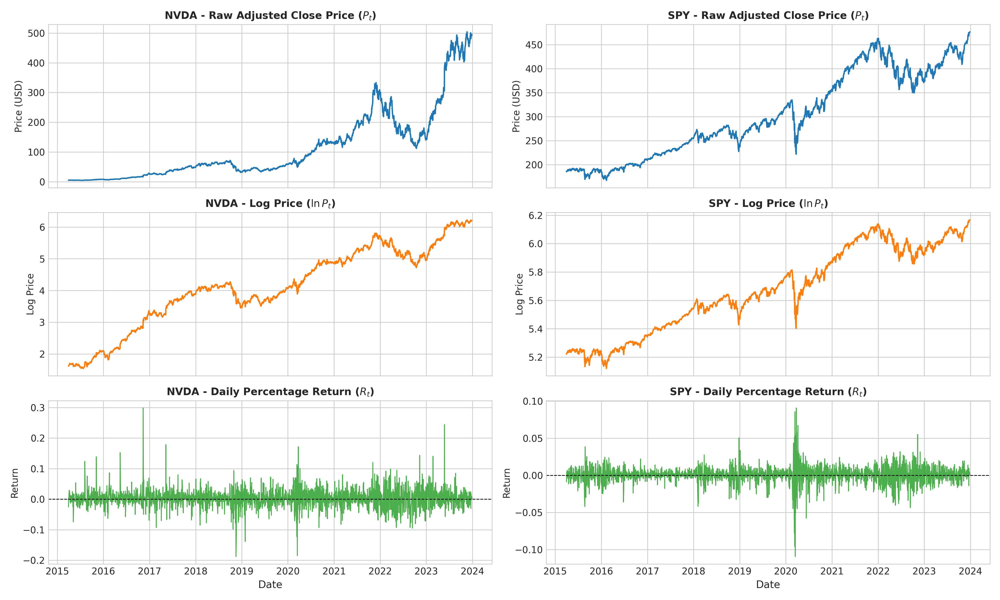

The statistical tests confirmed that **raw closing prices are strictly non-stationary** (ADF p > 0.20, KPSS p = 0.01). Stock prices wander upward or downward with long-term trends and stochastic drift. Taking the log of prices helps compress exponential growth, but it still remains non-stationary.

However, when we computed the **daily percentage returns** ($R_t = \frac{P_t - P_{t-1}}{P_{t-1}}$), the series became **strictly stationary** across all 6 assets (ADF $p = 0.0000$, KPSS $p = 0.10$). 

**Takeaway for Modeling:** If we use an ARIMA baseline, we must difference the price series ($d=1$). For our LSTM neural network, we should feed stationary daily returns and normalized indicators rather than raw dollar prices.

---

## 2. Tomorrow's Return Is Hard to Predict, but Volatility Clusters Strongly

We checked whether past price returns can linearly predict future returns, and whether market risk comes in clusters. So, we plotted the Autocorrelation Function (ACF) and Partial Autocorrelation Function (PACF) for daily returns, along with the ACF of squared returns ($R_t^2$).

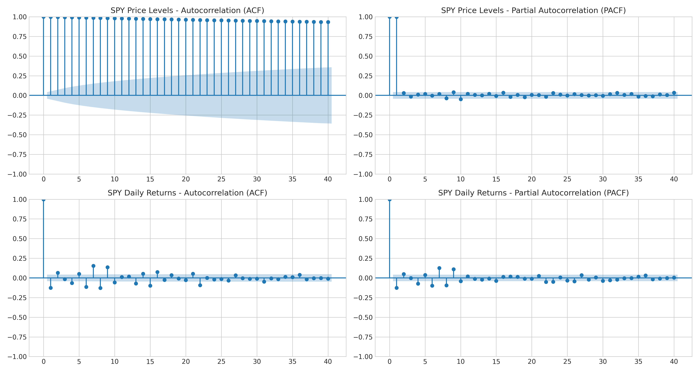

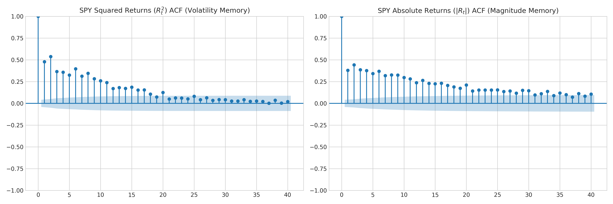

The daily return ACF drops to near zero immediately at lag 1, which aligns with weak-form market efficiency: you cannot easily predict tomorrow's return simply by looking at today's return linearly.

However, the ACF of **squared returns ($R_t^2$) tells a completely different story**. It stays positive and statistically significant for over 30 trading days. This proves strong **volatility clustering**: high-volatility days are followed by high-volatility days, and calm days follow calm days.

**Conclusion**: Linear ARIMA models assume constant variance and completely miss these risk cycles. An LSTM neural network with recurrent memory gates is much better suited to capture these non-linear volatility regimes.

---

## 3. Stock Returns Have Heavy Tails and Severe Downside Crashes

Many financial models assume market returns follow a normal bell curve. We tested this by measuring return distributions, excess kurtosis, and historical drawdowns (how far prices fell from their previous peak).

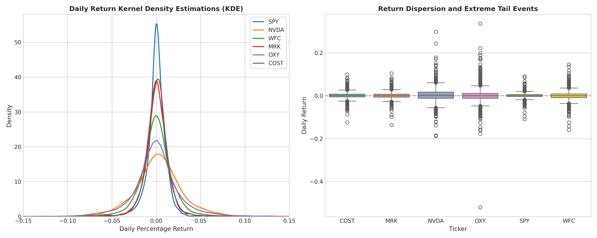

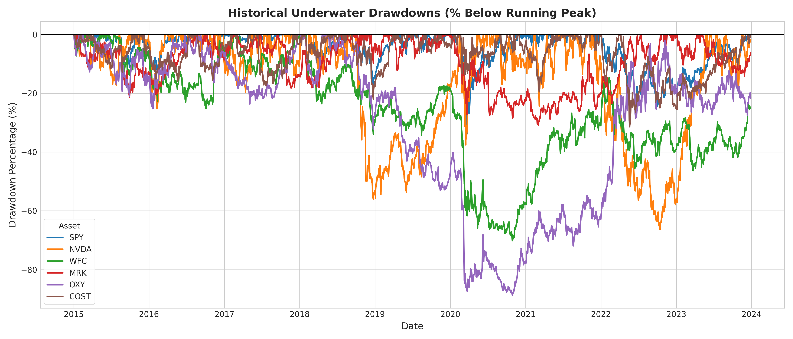

Every single asset showed massive excess kurtosis, meaning the market has **fat tails** where extreme gains and crashes happen much more often than a normal distribution expects. For example, OXY had an excess kurtosis of 44.40, SPY had 12.50, and NVDA had 9.16 (a standard normal bell curve has 0.0).

Looking at historical peak-to-trough drawdowns, OXY dropped -88.65% during the 2020 oil collapse, Wells Fargo fell -70.17%, and Nvidia pulled back -66.34% during the 2022 tech slump.

**Observation:** Standard loss functions like Mean Squared Error (MSE) treat upside gains and downside crashes equally. For our risk analyzer, using quantile loss functions or tracking Value-at-Risk (VaR) will give us a safer, more realistic risk model.

---

## 4. Different Sectors React Differently to Macroeconomic Shocks

Our dataset covers five distinct sectors plus the broad market benchmark (SPY). We compared their long-term growth trajectories and analyzed how they performed during the March 2020 COVID-19 crash versus the 2022 interest rate hike cycle.

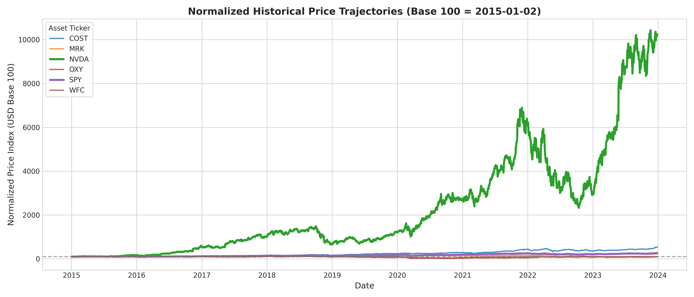

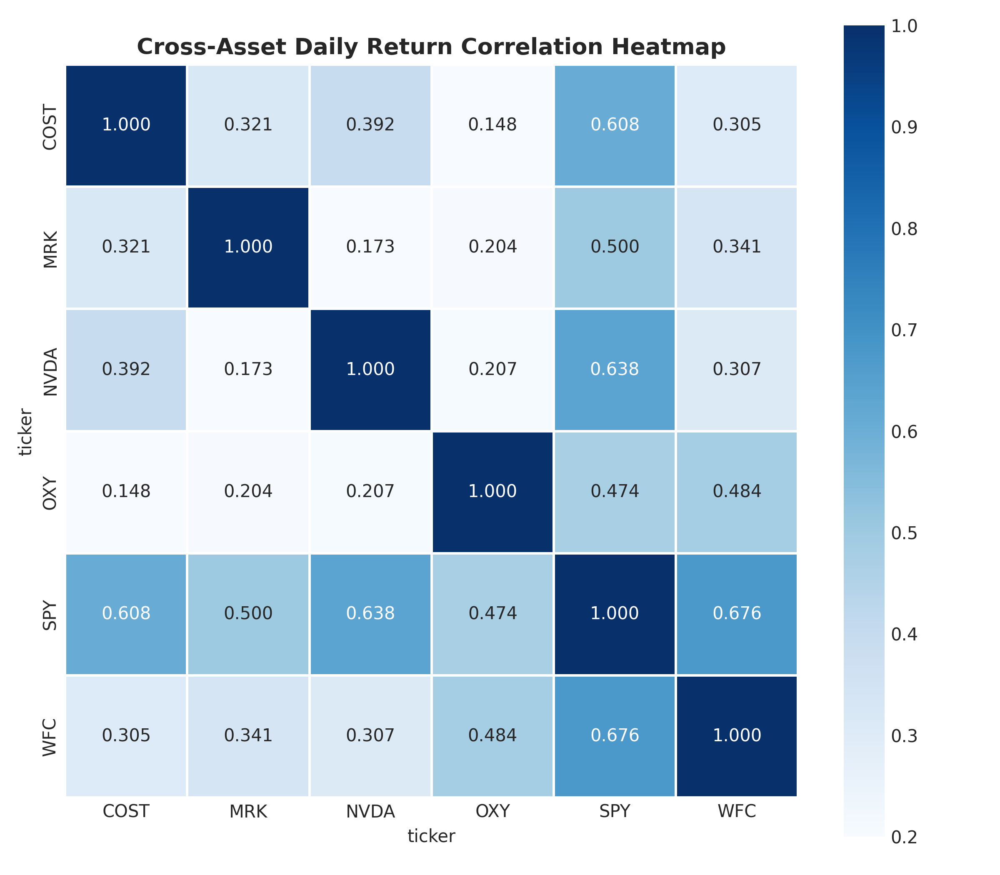

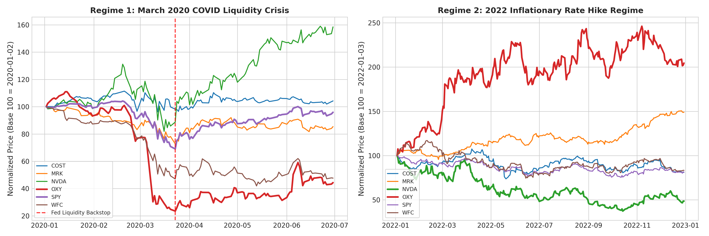

Over the 9-year historical period, performance diverged drastically: Nvidia gained +10,147% due to GPU and AI demand, Costco gained +432%, SPY gained +158%, Merck gained +125%, while OXY fell -2.5% and Wells Fargo fell -9.5%.

More importantly, the two crisis periods revealed how market regimes shift:

- **March 2020 Shock:** All stocks plunged together in a liquidity panic. Cross-asset correlations spiked toward 1.0.

- **2022 Rate Hike Regime:** The sectors decoupled. Rising interest rates punished high-multiple growth tech (NVDA plunged ~50%), while commodity inflation drove energy stocks upward (OXY surged +115%).

**Takeaway:** An isolated stock model will miss broad market regime shifts. Including SPY benchmark returns, excess returns, and a rolling 60-day Beta gives our multivariate LSTM the macro context needed to recognize whether a selloff is company-specific or market-wide.

---

## 5. News Timestamps Require a 1-Day Delay to Prevent Look-Ahead Leakage

Financial news can be a useful market signal, but only if the model receives the news before the trading session starts. We checked the publication dates in our news dataset to establish safe alignment rules.

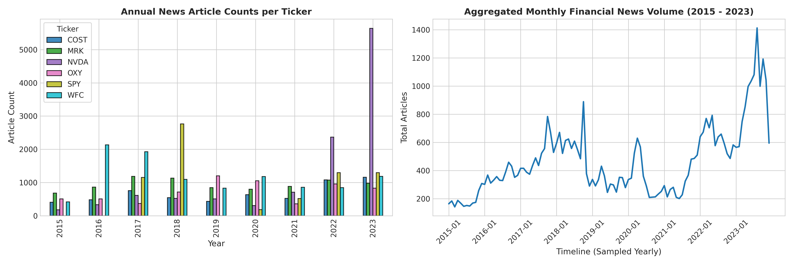

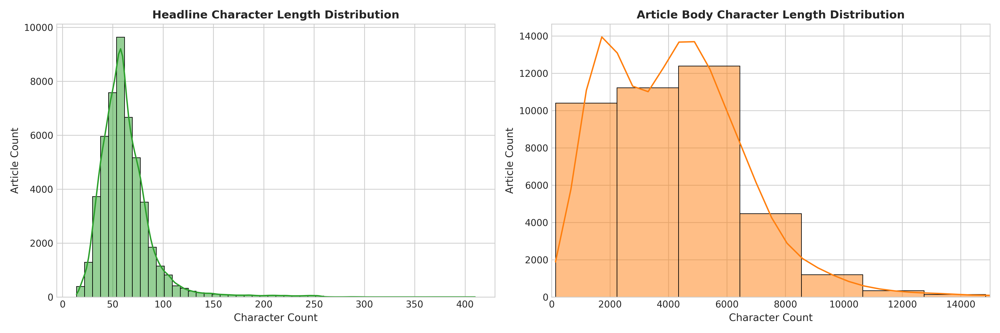

The audit revealed that 99.85% of news timestamps (49,846 out of 49,921 articles) are set to 00:00:00 UTC. This means the source data did not record the exact minute of publication during the day.

If we used an article dated Monday to predict Monday's closing price, the model could accidentally peek into news that came out after the market opened (look-ahead bias). To guarantee zero leakage, we mapped each article to the **first trading session strictly after publication date** (i.e., effective_trading_date). Articles published on Friday, Saturday, and Sunday are safely assigned to Monday's trading session.

For rows where the article body is missing (18.28%), we created an engineered field `text_for_finbert` that uses the headline and any available text snippet.

---

## 6. How We Handle Days Without News and Why News Volume Matters

We checked how often each stock had news articles and investigated what happens when a trading day has no news.

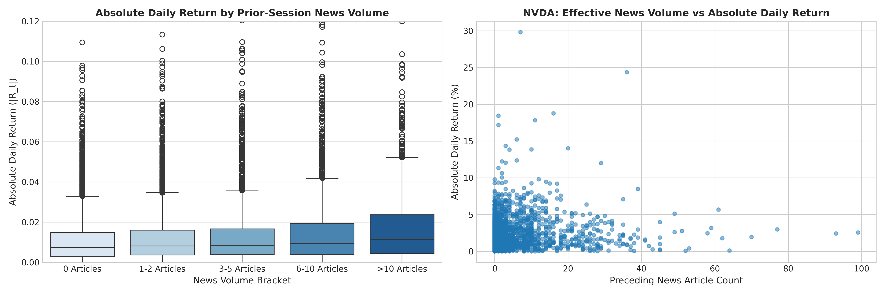

News coverage frequency varies significantly by company:

- **Merck (MRK):** 91.56% of trading sessions had news (2,072 days)

- **Wells Fargo (WFC):** 89.62% of trading sessions had news (2,028 days)

- **Costco (COST):** 84.31% of trading sessions had news (1,908 days)

- **Occidental (OXY):** 82.55% of trading sessions had news (1,868 days)

- **Nvidia (NVDA):** 63.10% of trading sessions had news (1,428 days)

If we dropped days that had no news, Nvidia would lose nearly 37% of its trading days, breaking the continuous daily sequence that time-series models need. 

Instead, we used a **dual-track approach**:

1. Keep all 2,263 contiguous trading days for price modeling.

2. For days without news, record `news_count = 0` and `has_news = False` without inventing fake neutral sentiment.

As shown in Figure 15, on days with **more than 10 articles**, the average absolute price return was **2.82%**, compared to **1.38%** on zero-news days. This confirms that news volume itself acts as a strong indicator of market attention and volatility.

---

## Summary Matrix

| Question | What We Found | Why It Matters for Modeling |
| :--- | :--- | :--- |
| **Are stock prices stationary?** | Prices have unit roots ($I(1)$); Daily returns are stationary ($I(0)$). | ARIMA requires differencing ($d=1$). LSTM should train on stationary returns and scaled features. |
| **Is there linear price memory?** | Daily return autocorrelation drops to zero at lag 1. | Markets are weak-form efficient; raw returns cannot be predicted with simple linear lags. |
| **Is there non-linear memory?** | Squared returns ($R_t^2$) stay positively correlated for over 30 days. | Strong volatility clustering (ARCH effect). An LSTM's gated memory is well suited for this. |
| **Are returns normally distributed?** | Excess kurtosis ranges from 8.5 to 44.4 with drawdowns up to $-88.6\%$. | Normal distribution severely underestimates crash risk; quantile loss functions are preferred. |
| **Do stocks move together?** | 2020 crashed together; 2022 saw NVDA fall $-50\%$ while OXY rose $+115\%$. | Macro regimes switch over time. Multivariate features (SPY return, Beta) are essential. |
| **How to prevent news look-ahead?** | 99.85% of news timestamps are midnight `00:00:00` UTC. | Conservatively map news to the *next* trading day ($D \to T > D$) to eliminate leakage. |
| **What to do when news is missing?** | Coverage is 63% to 92%. Days with >10 articles have double the price volatility. | Keep all 2,263 trading days; flag `news_count=0`; use news volume as an attention indicator. |
